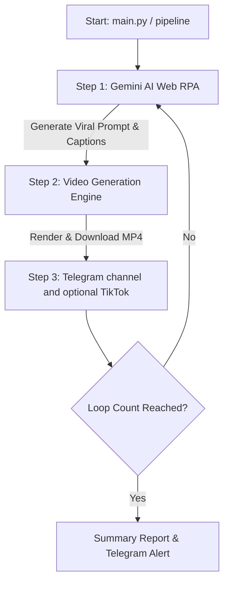

# 🤖 Auto Video Pipeline - Autonomous Video & TikTok Bot

An end-to-end autonomous RPA video generation and social media publishing pipeline that coordinates **Gemini Web**, **Google Flow / Helios / Short Video Maker**, and **TikTok Creator Center** with Playwright, self-healing selectors, and Telegram notifications.


---

## 🔄 3-Step Autonomous Pipeline



---

## ✨ Features

- 🧠 **AI Script & Prompt Generation**: Integrates with Gemini Web to dynamically construct viral video prompts and captions.
- 🎬 **Multi-Engine Video Generation**: Supports Google Flow, Helios engine, and Short Video Maker server.
- 🛡️ **Self-Healing Selectors**: Built-in AI-assisted selector fallback (`self_healer.py`) to prevent DOM breakages.
- 📢 **Instant Notifications**: Automated Telegram bot alerts with progress logs and error reporting.
- ⏰ **Automated Scheduling**: Ready-to-go Cron and Task Scheduler scripts (`run.sh`, `schedule_helper.py`).
- 🛑 **Ad-Blocker & Session Guard**: Built-in uBlock Origin and session persistence to keep logins alive without interruptions.

---

## 📁 Project Structure

```
auto_video/
├── config.py                     # Loop count, endpoints, Gemini templates, and selectors
├── main.py                       # Main 3-step autonomous execution loop
├── auto_short_video_pipeline.py  # Standalone automated video generation pipeline
├── gemini_handler.py             # [Step 1] Gemini Web RPA module
├── helios_handler.py             # [Step 2] Helios engine video generator
├── short_video_maker_handler.py  # [Step 2] Short video maker API handler
├── tiktok_handler.py             # [Step 3] TikTok Creator Center uploader & publisher
├── self_healer.py                # AI-powered selector healing engine
├── notifier.py                   # Telegram notification dispatcher
├── setup_adblocker.py            # Automated uBlock Origin extension setup
├── run.sh                        # Launch script for Cron / Task Scheduler
├── requirements.txt              # Core Python dependencies
├── .env.example                  # Environment configuration template
│
├── utils/
│   ├── browser_manager.py        # Persistent user_data_dir & AdBlock manager
│   ├── popup_handler.py          # Cookie banner & dialog closer
│   ├── session_guard.py          # Safe pause-and-resume session handler
│   └── logger.py                 # ANSI color terminal logger
│
├── custom_assets/                # Backgrounds, fonts, and watermarks
├── extensions/                   # Browser extensions (uBlock Origin)
└── logs/                         # Execution logs and failure screenshots
```

---

## 🚀 Getting Started

### Prerequisites

- Python 3.10 or higher
- Playwright Chromium browser installed

### Installation

1. Clone the repository:
   ```bash
   git clone https://github.com/Yes526-tech/auto_video.git
   cd auto_video
   ```

2. Create and activate a virtual environment:
   ```bash
   python3 -m venv venv
   source venv/bin/activate
   ```

3. Install dependencies:
   ```bash
   pip install -r requirements.txt
   playwright install chromium
   ```

4. Configure environment variables:
   ```bash
   cp .env.example .env
   # Edit .env and enter your Telegram token and configuration
   ```

5. Setup ad-blocker extension:
   ```bash
   python3 setup_adblocker.py
   ```

---

## ⚡ Running the Pipeline

Set `TELEGRAM_BOT_TOKEN` and `TELEGRAM_CHANNEL_ID` to publish each generated MP4 to your channel. TikTok publishing is off by default. See [Telegram setup](TELEGRAM_BOT_SETUP.md) for permissions, scheduling, and duplicate protection.

### Run Full Autonomous Bot
```bash
python3 main.py
```

### Run Custom Video Batch
```bash
python3 generate_5_videos.py
```

---

## ⏰ Daily Scheduling (Cron on macOS / Linux)

To automatically execute daily at 08:00 AM:

```bash
crontab -e
```
Add:
```bash
0 8 * * * /path/to/auto_video/run.sh
```

---

## 📄 License

MIT License.
